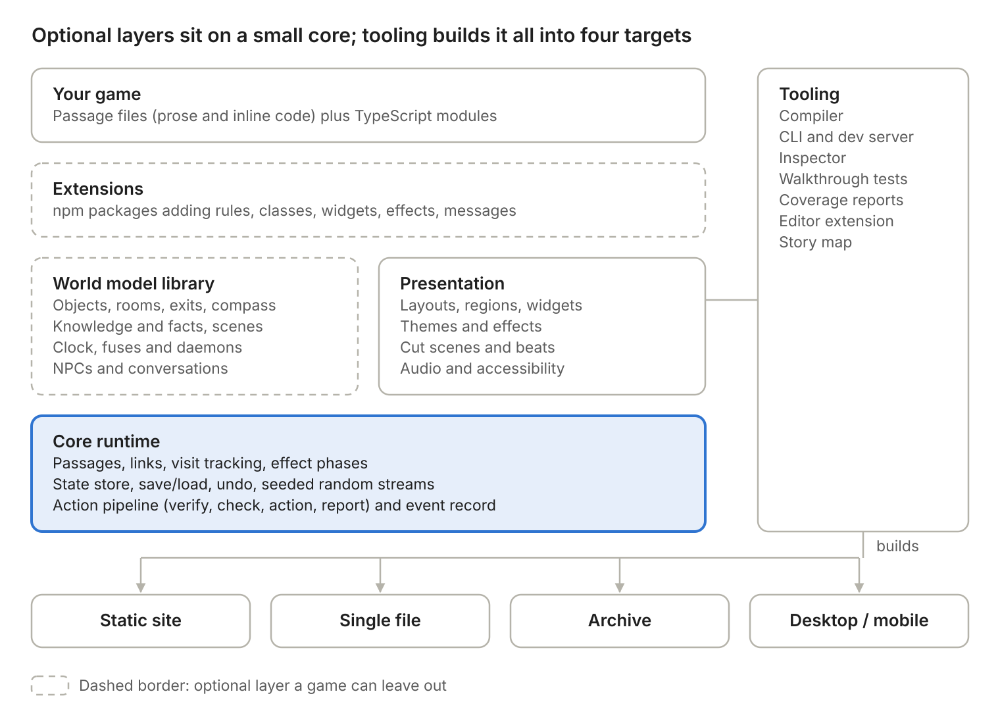
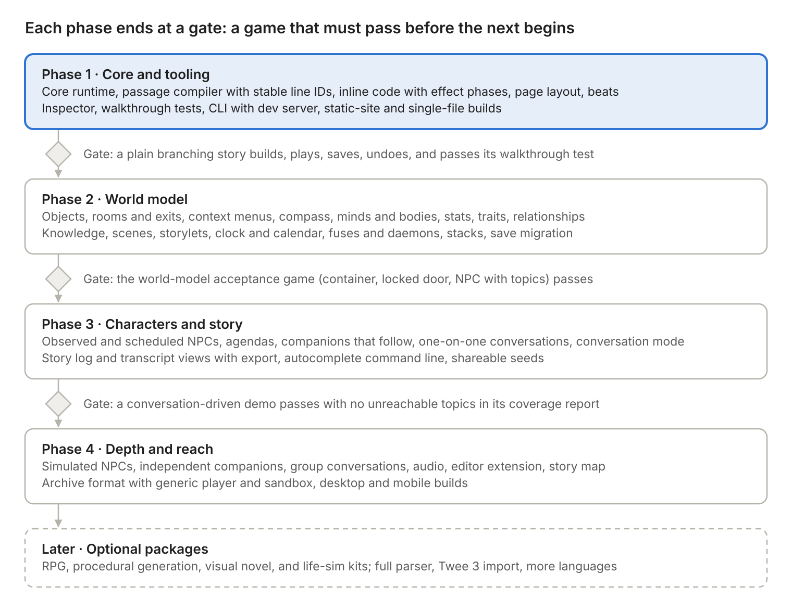

# Loominate IF — Design Document

Nov 7, 2026 · @eric

## Overview and goals

Loominate IF is a programmer-oriented authoring framework for interactive fiction: twee-style passage files plus TypeScript, compiled into games that run in any browser, as a desktop app, or on mobile. It pairs Twine's ease of publishing with the rich, optional world model of TADS 3 and Eric Eve's adv3Lite library.

**Who it's for.** Programmers who want a real framework with a real world model. Writers who want no code at all are already well served by Twine, so the system does not try to compete there.

**Goals.**

- A plain branching story can be written with no world model at all, and the world model can be adopted later without rewriting.
- A rich, adv3Lite-inspired world model is available on demand: objects, containment, rooms and exits, knowledge, scenes, time, NPCs, and conversations.
- Everything is extensible, including the library's own behavior, without forking.
- Debugging is a first-class feature, not an afterthought.
- Games build to a static site, a single HTML file, a portable archive, or a desktop/mobile app.
- The architecture is general enough to serve non-game uses later (tutorials, training simulations, decision aids), without designing for them now.

**Non-goals for version one.** A full natural-language parser (the action layer is parser-ready, but the parser ships later as an optional package), a visual editor, and a no-code authoring experience.

The name Loominate IF comes from *loom* and *illuminate*, with IF for interactive fiction. The CLI command is `loominate`. See Open questions for how the name was chosen.

## Design principles

These principles settle disputes later in the design; when two options conflict, the one that better serves these wins.

- **Use it or not.** Every layer above the core is optional. A story with no world model must never pay for it in syntax, size, or concepts.
- **State is data, behavior is code.** All mutable state lives in one serializable store keyed by stable IDs. Objects hold behavior and refer to state by ID. Save, undo, replay, and inspection all follow from this.
- **Rendering is pure; effects are explicit.** Text can be rendered any number of times without changing anything. State changes happen only in declared phases that run exactly once per real event.
- **Determinism.** Given a seed and a list of player actions, a playthrough reproduces exactly.
- **Everything can be explained.** For any visible or hidden choice, fired rule, or NPC behavior, the inspector can answer "why?"
- **Catch it at compile time.** Broken links, missing objects, and type errors in inline code are compiler errors, reported against the author's own source lines.
- **Open library.** Library behavior is built from the same hooks and rules authors use, so authors can insert, replace, or remove any of it.
- **Accessible by default.** Keyboard navigation, screen-reader output, and reduced-motion preferences work without author effort.
- **Stable public surface.** What authors and extensions touch is a versioned public API; everything else is internal.

## Architecture

The system is a small core runtime with optional layers above it and tooling beside it, so a plain story uses only the core and presentation while richer games add the world model and extensions.



Each layer depends only on the layers below it. Extensions can reach into any layer through rulebooks, hooks, and registries, and the inspector reads state from all of them.

## Source format

A game is written as passage files for prose and TypeScript modules for objects and behavior, compiled together and type-checked as one program. The format follows Tweego's `::` passages, with TADS-style prose that embeds expressions freely.

### Passage files

Passages are declared with `:: Name [tags]`. Tags are comma-separated and assign roles: `scene`, `room: platform`, `actor: butler`. Prose is the default; expressions and directives sit in `{ }`, and `\{` writes a literal brace. The full grammar is in [ADR 0004](decisions/0004-passage-syntax.md).

```
:: Arrival [scene]
The train is gone before you've finished stepping down.
{beat 1.5s}
Fog has swallowed the platform. Somewhere ahead, a lamp
gutters in the window of {station.theName}.
{wait}
You are not, it seems, expected.
{continue -> Platform}
```

### Inline code and effect phases

Passages can contain inline TypeScript. Conditional text and guarded links render freely; state changes happen only in declared phases.

```
:: Cellar Stairs
{on enter: if (!player.has(lantern)) player.fear += 1}

The steps go down further than they should.
{if lantern.isLit}
  Your lantern throws long shadows against the stone.
{else}
  You can't see the bottom.
{/if}

[[Go down -> Cellar]]{when lantern.isLit}
[[Back up -> Kitchen]]
```

- **Phases:** `on first visit`, `on enter`, `on leave`. Each runs exactly once per actual visit and is recorded in the undo history, so loading or re-rendering never repeats an effect.
- **Link guards:** `{when …}` right after a link hides or disables it. Each link can choose hidden, disabled, or disabled-with-reason, with a game-wide default. A hidden link inside a paragraph keeps its label as plain words, so the sentence still reads.
- **Visit tracking** is built into the core: `visited("Cellar")`, `visits`, `firstVisit`.

### TypeScript modules

Objects are defined declaratively with factory functions and object literals, aiming for the terseness of a TADS object definition while staying fully typed. The rules are in [ADR 0006](decisions/0006-object-definitions.md).

```ts
export const lantern = object("lantern", {
  name: "brass lantern",
  isLit: false,
  light() {
    this.isLit = true;
  },
});

export const station = place("station house", {
  in: town,
  description: t`Low, grey, and older than the railway.`,
});
```

- The first argument is the object's stable ID. Data properties are state, stored in the state store under that ID, and only values that differ from the definition are stored. Methods are behavior, with `this` typed from the definition. Getters are derived values.
- Mixins are objects spread into a definition, as in `object("cellar door", { ...lockable, name: "cellar door" })`.
- Array and object fields can be changed in place (`player.inventory.push(lantern)`), and references to other objects are stored as their IDs.
- Objects created during play come from templates: `spawn(match, matchbox)` creates `gen:matchbox:match-1`.
- Core provides `object()`; the world model's `place()`, `thing()`, and `actor()` build on it.

Printed text uses tagged templates (`t`) that support adv3Lite-style message parameters for articles, pronouns, plurals, and verb agreement. A `t` text is a pure function that renders each time it's called, so functions in `${}` read current state, and parameters such as `{The ${door}}` are looked up by name in a registry that the world model and kits fill. [ADR 0013](decisions/0013-text-templates.md) defines it.

### Compilation and checking

Each passage file (`.weft`) compiles to a virtual TypeScript module, the technique Svelte, Vue, and MDX tooling use. This gives inline code real type checking, autocomplete, and source maps that point at passage lines. The module is the compiled passage code itself. Inline code sees the exports of the game's scope module (`story.ts` by default) without importing them, and refers to passages by name as checked strings, as in `visited("Cellar Stairs")`; see [ADR 0005](decisions/0005-passage-modules.md). The compiler reports:

- links to passages that don't exist, and unreachable passages
- references to undefined objects, topics, or facts
- passages tagged as rooms that aren't connected to one
- type errors inside inline code

### Stable line IDs

The compiler assigns every authored line of prose and dialogue a stable ID that survives edits to surrounding text (Phase 1). Line IDs enable skipping only previously read text across playthroughs, mapping voice files to lines, and line-by-line localization.

A line is a source paragraph or a link label. Its ID is the passage name and a hash of the line's own text, as in `Cellar:k3f9a2`, so editing other lines never changes it. `{line name}` above a line pins its ID to `Cellar:name`, so a typo fix doesn't orphan a voice file or translation. See [ADR 0007](decisions/0007-line-ids.md).

```
:: Cellar
It's dark.

{line drip}
Water drips.
```

## Core runtime

The core runtime knows only passages, state, choices, the event record, save/load, and undo; everything else builds on it.

**Templates and instances (Phase 1 data-model rule).** Besides objects defined in source, the state store supports instances created at runtime, stored as template plus parameters plus mutable state, with behavior from the template. Instances get deterministic IDs derived from their origin (for example `gen:crypt-3:room-7`), so replays and shared seeds produce identical IDs. The API distinguishes static references, checked by the compiler, from dynamic queries such as `world.find(...)`. This keeps generated content compatible with save, undo, replay, and the inspector, and makes the procedural generation kit possible later.

- **State store.** One serializable store holds all mutable state, keyed by stable, author-visible IDs. Objects never hold mutable state privately.
- **Undo.** History stores diffs rather than full snapshots, so long sessions stay small. Undo is unlimited by default, with an author-configurable cap.
- **Event record.** All output is recorded as structured, tagged events (narrative, scene, dialogue, room description, action result, navigation, system message) rather than written directly to the screen. The page, story log, and full transcript are all views of this record.
- **Visit tracking.** Visits per passage and per location are tracked automatically.
- **Saving.** Autosave, multiple named slots, and export/import of save files. A save is the whole state snapshot (so it carries the event record, action log, and seed) plus the game and engine versions; undo history starts afresh on load. Core keeps slots in storage the host supplies, and the player shell calls autosave after each action. [ADR 0010](decisions/0010-save-format.md) defines the format.
- **Save durability.** Saves carry the game version and engine version. Authors supply migration hooks so saves from version 1.0 load in 1.1. Stable IDs make most migrations unnecessary.
- **Persistent cross-playthrough data.** A separate store for achievements, unlocked endings, and settings that survives restarts and is never touched by undo. Effects reach it as `context.persistent`, read-only while rendering. The story copies it into game state when it begins, so replays play against the data the original began with, never the player's own. [ADR 0011](decisions/0011-persistent-store.md) defines it.

## Presentation

The default presentation is page-oriented, like Twine, with layouts built from reskinnable regions and widgets so each game can carry a look that suits its theme.

### Page model

Each passage or action result replaces the main view. A "story so far" drawer gives in-play scrollback from the event record. Because all output flows through the event record, an author can build a transcript-style presentation later without changing the model.

### Layouts, regions, and widgets

- A **layout** defines named regions: header, footer, sidebars, main view.
- **Widgets** live in regions: compass, inventory, status line, clock, auto-map, conversation topics. Authors and extensions can write their own.
- Widgets are **headless**: the runtime supplies the logic and state; presentation is separate. Presentation itself uses vanilla DOM, and a widget's view can be written with any UI framework through a small mount/update/unmount contract ([ADR 0003](decisions/0003-ui-rendering-approach.md)).
- Games can switch layouts at runtime; conversation mode is the first built-in example.
- Mobile rules collapse sidebars into drawers or tabs on narrow screens.

### Theming

Light customization uses CSS custom properties in a theme file. Deep customization replaces a widget's render template entirely, so the same compass data can drive a brass ship's compass, a subway map, or a list of street names.

### Cut scenes and beats

A scene is a sequence of beats the runtime understands: timed pauses, waits for a click, paced reveals, and continue points. Because beats are first-class:

- players can skip or fast-forward, essential on replays
- reduced-motion settings and screen readers get the text immediately
- save and undo happen cleanly at beat boundaries
- scenes can trigger world events mid-sequence

Long introductions use the same machinery for paging, so they don't need to be split into many tiny passages.

### Effects

Fades, typewriter text, screen shakes, and similar effects are named effects usable from passages, with an API for registering new ones. Raw DOM access remains as an escape hatch, not the main path.

### Audio

Music, ambience, and sound-effect channels with crossfades, a volume UI, and handling of browser autoplay restrictions. Beats can trigger sounds.

### Accessibility

New text is announced through live regions, focus moves sensibly after each choice, every widget is keyboard-operable (including numpad or vi-style compass keys), and reduced-motion preferences disable animated effects.

## Actions and interaction

Players act through dynamic context menus whose options are contributed by the world's current state, all built on a single action pipeline that a parser can later share.

### The action pipeline

Every action, whether from a menu, a passage link, an NPC, or a future parser, runs through the TADS-style stages:

1. **Verify:** is the action sensible here? Determines whether it is offered at all.
2. **Check:** is it allowed right now? Failures can be shown as disabled with a reason.
3. **Action:** perform it, including its time cost.
4. **Report:** describe the outcome into the event record.

### Dynamic context menus

Opening an object's menu gathers candidate actions from every relevant source: the object, carried items, the player's knowledge, the location, active scenes, and extensions. Each action decides whether it is hidden, shown, or disabled with a reason, and can compute its own label.

```ts
action("tune-emergency", {
  on: radio,
  label: "Tune to the emergency frequency",
  when: () => radio.isAssembled && player.knows(facts.emergencyBand),
  run: () => scene.start(distressCall),
});
```

Multi-object actions ("Use the crowbar on the crate") are offered only when all participants are present. The inspector can list which conditions hid any action.

### Autocomplete command line

An optional keyboard-driven command line accepts only actions the menus would currently offer, with autocompletion. It feels parser-like without ever producing "I don't understand."

### Future parser

A full parser is a later optional package. To keep that possible, actions can optionally carry verb phrases and objects can optionally carry vocabulary from version one, so the parser becomes a second front end on the same pipeline with no changes to game logic.

## World model library

The world model is an optional library inspired by adv3Lite; a game imports it when it needs objects, places, and knowledge, and pays nothing when it doesn't.

**Minds and bodies (Phase 2 data-model rule).** An actor is two linked objects. A **mind** holds knowledge and memories, personality traits, relationships, agendas and schedules, and conversation abilities. A **body** holds location, inventory and equipment, appearance, physical traits and stats, senses, and health. A mind *inhabits* a body; that link is ordinary state, covered by save, undo, and the inspector. The player character is not special: the player controls one mind, and every action records both the acting mind and the body that performed it.

| Scenario | What changes |
| --- | --- |
| Switching the player character | The player controls a different mind |
| Possession | A mind moves into another body, displacing the original mind or sharing as a passenger |
| Body swap | Two minds exchange bodies |
| Empty body | No mind: inert, or driven by an author-defined instinct behavior |
| Disguise, mask, shapeshifting | Appearance diverges from identity |

- **Perception** goes to the inhabiting mind, and optionally to a passenger mind.
- **Perceived identity.** NPCs see bodies, not minds; who they think they are addressing is a belief in their knowledge. Relationships are keyed by minds, but NPC responses depend on who they believe is present.
- **Narration.** "You" follows the player's mind; descriptions come from the body.
- **Simple by default.** `actor(...)` creates a permanently linked mind and body and routes properties to the right half, so games that never use possession or swaps never see the split.

```ts
export const mira = actor("Mira", { courage: 3, strength: 2 });
// courage → mind, strength → body; permanently linked by default

possess(villain.mind, mira.body);  // villain now controls Mira's body
swapBodies(player.mind, tom.mind); // classic body swap
```

- **Objects and containment.** Things, containers, surfaces, and locations, with a containment tree and scope (what the player can see, reach, or hear). Mixins provide the multiple-inheritance flavor of TADS classes.
- **Rooms and regions.** Rooms group into regions for shared rules, descriptions, and ambience. A room can be linked to a passage via the `room:` tag.
- **Exits and directions.** Rooms declare exits, optionally with distances or travel times and with doors or other obstacles. Directions are a registry, not a fixed eight: up/down/in/out and themed sets such as fore, aft, port, starboard can be added.
- **Compass widget.** An optional widget that asks the current location for its exits and their passability, so locked doors appear disabled with the door supplying the reason. Authors choose whether unvisited exits show destination names. Fully reskinnable, keyboard-operable.
- **Knowledge and facts.** The player and NPCs track what they have seen, what is familiar, and which facts they know. Facts can carry a source ("the gardener told me" versus "I read it in the diary"). Knowledge drives available actions and conversation topics.
- **Scenes.** Named periods of the story with start and end conditions, able to add rules, actions, and topics while active.
- **Perception.** A sense layer decides what the player notices: NPC arrivals and departures are narrated automatically, and offstage events are silent unless made perceptible ("You hear a door slam upstairs").

### Storylets and stackable items

- **Storylets.** A pool of events that become eligible as conditions are met (relationship level, weather, place, day). The runtime selects among eligible events by priority, with once-only rules, cooldowns, and recency, in the style of quality-based narrative. Useful across genres: dating and life sims, roguelikes, open worlds.
- **Stackable quantities.** Countable stacks that split and merge, so ninety-nine turnips are one stack, not ninety-nine objects.

## Time and scheduling

The primary clock is an in-world clock measured in minutes; most actions are free, travel costs time, and any action can advance the clock explicitly.

- **Action costs.** Zero by default. Travel derives its cost from the route. Any action or inline code can advance time, including partway through an action.
- **Action counter.** A secondary per-action counter exists for things that should happen "every move."
- **Fuses and daemons.** A fuse fires once at a time or after a delay; a daemon recurs. Both are cancellable objects in the state store, visible to save, undo, and the inspector.

```ts
const collapse = fuse({ after: minutes(30) }, () => {
  bridge.collapse();
  narrate(t`Somewhere behind you, timber gives way with a roar.`);
});
```

- **Time jumps.** Sleeping or long travel advances the clock step by step to each scheduled event, firing them in order. Any event can interrupt the jump ("You're woken at 3 a.m. by footsteps"), leaving the clock at that moment.
- **Tie-breaking.** Events scheduled for the same minute fire in a deterministic priority order.
- **Time-aware content.** Descriptions and actions can vary by time of day; locations can have opening hours enforced through the same rules that gate doors; scenes can start at a time.
- **Wait actions.** "Wait" and "wait until" are ordinary actions.
- **Game time versus presentation time.** A cut scene's beats take real seconds; whether the scene costs game minutes is a separate, explicit choice.

* **Calendar.** A calendar layer on the clock provides days, weekdays, seasons, years, and holidays, so schedules can say "Tuesdays and Thursdays" and storylets can say "the first day of summer."
* **Lazy processes.** Large numbers of timed processes (crop growth, item decay) are computed when observed rather than run as individual daemons, generalizing the scheduled-NPC approach so big simulations stay fast.

## Randomness

All randomness comes from named, seeded streams stored in the game state, so playthroughs replay exactly and players can share seeds that produce the same world.

- **Named streams.** Each system draws from its own stream derived from the master seed (world setup, weather, combat, and so on). A shared seed reliably produces the same world even when players make different choices, and adding a roll to one system in a later version doesn't shift the others. Streams are hierarchical: a substream keyed by name (the seed plus "level-3") gives the same results whenever it is first used, regardless of what the player did before.
- **Shareable seeds.** Displayed as memorable words ("amber-lantern-fog") and tied to the game version. Authors can fix the seed or hide seed entry. A "seed of the day" is possible.
- **Replay.** A seed plus an action list reproduces any playthrough; bug reports can be small replay files that open in the inspector.
- **Undo behavior.** Undoing and retrying gives the same result, preventing reroll-by-undo. Authors can opt individual streams out with `randomStream("fortune", { undo: "reroll" })`: its draws in each action come from the action's number and how many times it was tried, which undo doesn't rewind and replays record ([ADR 0014](decisions/0014-reroll-streams.md)).

Streams are defined in modules and drawn from in effects; [ADR 0008](decisions/0008-random-streams.md) fixes the generator and how stream seeds are derived.

The story logs each action the player takes (following a choice, or moving straight to a passage) in the state store, so undo trims the log and saves carry it. `story.toReplay()` gives the seed and log as a replay, `writeReplay` and `readReplay` turn it into a small JSON file and back, and `story.playReplay()` reproduces the state and event record exactly, naming the first action that no longer fits if the game has changed. [ADR 0009](decisions/0009-replay-files.md) defines the log and the file format.

```ts
export const weather = randomStream("weather");
export const dungeon = randomStream("dungeon");

// {on first visit: crypt.layout = dungeon.substream("crypt").pick(layouts)}
// {on enter: if (weather.chance(0.3)) road.raining = true}
```

## NPCs

Each NPC chooses one of three simulation levels, so authors spend effort only on the characters who need it.

| Level | Behavior | Author cost | Best for |
| --- | --- | --- | --- |
| Observed only (default) | Acts only when the player is present or a scene moves them | None | Most minor characters |
| Scheduled | Follows a timetable; the runtime computes where they are whenever it matters, with no step-by-step simulation | Low | Households, shopkeepers, background life |
| Simulated | Travels room to room on daemon-driven paths and acts on the world offstage | High | Key antagonists and rivals |

- **Shared rules.** NPC actions use the same action pipeline as the player's, so locks, keys, and other rules apply equally.
- **Agendas.** adv3Lite-style agenda items give NPCs goals that can interrupt their schedules ("find the player and deliver the warning").
- **Perception.** NPC movement in view is narrated automatically via the world model's perception layer.
- **Inspector support.** A view of where every NPC is, what they're doing and why, and a timeline of their offstage actions.

## Conversations

Conversations follow adv3Lite's model of topic entries that declare when they apply, presented in a dedicated conversation mode and designed for group conversations from the start, with one-on-one as a group of one.

### Topic entries

- Topics cover asking, telling, showing, giving, and yes/no answers, plus greetings and goodbyes (including implicit ones).
- Topics live on the actor, the actor's current state (on duty versus off), a conversation node, or an active scene.
- Each has conditions and a match priority; the most specific match wins.
- Repeated topics use event lists that cycle, stop at the last response, or shuffle.
- Topics are suggested only when the player knows the subject. Responses can reveal facts to the player and inform NPCs.
- Showing and giving are ordinary actions that route to show and give topics.
- With the autocomplete command line, "ask butler about" offers every known topic, with sensible defaults for topics the NPC has no special response to.

### Authoring

Dialogue lives in passage files, one block per topic entry, using the same effect phases as passages:

```
:: Butler [actor: butler, state: onDuty]

{ask letter, when: player.knows(facts.missingLetter)}
"The letter, sir? I placed it on the desk myself.
Before supper, it would have been."
{reveal facts.butlerHandledLetter}

{ask letter, again}
"As I said, sir. On the desk."

{show photograph}
He studies it a moment too long. "I couldn't say, sir."
```

### Conversation nodes

Nodes handle moments that need structure, such as an NPC asking a question. A node can restrict options to its replies or add them alongside regular topics. If the player changes the subject, the NPC can press the point.

### Conversation mode

- Conversations switch to a conversation layout that focuses on the characters (portraits with changeable expressions, dialogue, topic options) while the room recedes. The layout is reskinnable or replaceable.
- The player starts a conversation, or an NPC starts one through an agenda item.
- Conversations end by goodbye, or by world events: the NPC leaves on schedule, a fuse fires, a scene takes over.
- Inventory stays available for showing and giving.
- Each exchange costs game time, one minute by default.

### Exit control

| Level | Behavior |
| --- | --- |
| Free (default) | Goodbye is always available |
| Soft block | The NPC objects, but the player can insist |
| Hard lock | Only the node's replies are available until one is chosen |
| Hear me out | A cut scene within the conversation; control returns afterward |

The compiler or test runner verifies every locked node has a reachable way out, the inspector shows active locks and their source, and undo always works through locks.

### Group conversations

- The player chooses an addressee (highlighted portrait), and the menu shows that character's topics. Group-level topics address everyone.
- Topic entries can trigger reactions from other participants, limited by priority and a per-exchange cap. NPCs can exchange scripted lines as beats.
- Everyone present hears what's said and learns revealed facts. Topics can depend on who is present:

```
:: Maid [actor: maid]

{ask letter, when: present(butler)}
She glances at the butler. "I wouldn't know, miss."

{ask letter, when: !present(butler)}
"He took it, miss. I saw him put it in his coat."
{reveal facts.butlerTookLetter}
```

- Private asides limit who hears a line.
- Participants can join or leave mid-conversation, with arrivals and departures narrated and the menu updating.
- Locks have an owner (the character or node demanding an answer), and the story log attributes speakers.

A coverage report flags unreachable topics and facts no one can be asked about, and a per-character view lists every topic with its conditions.

## Stats, traits, and relationships

Stats, traits, and relationships are a shared module used by any game or kit, so life sims, dating sims, and the RPG kit build on the same foundation.

- **Traits need no kit.** A trait is a plain typed property on any object or actor (a flag, a value, or a set of tags), defined in ordinary TypeScript. Passages, topics, storylets, and actions can all test traits directly.
- **Stats and resources.** Numeric stats, skills, and spendable resources (energy, money, hit points), with derived values. Each stat declares whether it is physical (stays with the body) or mental (travels with the mind).
- **Modifiers.** Buffs, debuffs, and bonuses with sources and durations, visible in the inspector.
- **Relationships.** A directed store keyed by pairs of minds, covering player-to-NPC and NPC-to-NPC, with multiple dimensions per pair (affection, trust, rivalry) and thresholds that trigger events. Combined with presence and knowledge, this supports jealousy, reputation, and gossip.

## Companions

A game has one player character plus optional companions, who are ordinary NPCs with extra states; this gives most of what a party offers, including splitting up, without a separate party system.

| State | Behavior |
| --- | --- |
| Accompanying | Moves with the player; movement is narrated as a group ("You and Mira head down the corridor") |
| Waiting | Stays put when asked |
| Independent | Sent off with an agenda (go, explore, return or wait), handled by the scheduled or simulated NPC levels |

- **Following.** The player can follow any NPC who leaves, reusing the same movement machinery, as TADS's follow command did.
- **Orders are actions.** "Ask Mira to wait here" or "Ask Tom to pick the lock" go through verify and check, so companions can refuse, and their own skills and inventory are used. Giving and taking items between characters are ordinary actions.
- **Splitting up.** What a companion sees while away becomes their knowledge, sourced to them. On reunion, "What did you find?" becomes a topic that reveals those facts; the story log records the report as dialogue. Offstage danger is a fuse or daemon.
- **Knowledge sharing.** Knowledge is per-actor with an author-chosen policy: shared while together, shared when reunited (default), or only through conversation.
- **Combat control.** Each companion is player-controlled or AI-driven in encounters, set per character.
- **Switching the player character.** A game can change which actor the player controls, for example cutting to Mira's minutes in the library before returning.

## RPG kit

Combat, spells, and skills are an optional package built on the action pipeline, clock, random streams, and layouts, providing rules-agnostic building blocks plus a simple default ruleset in an old-school spirit.

### Building blocks

- **Stats and resources:** hit points, spell points, fatigue, and author-defined stats, provided by the shared stats module.
- **Modifiers:** buffs, debuffs, and equipment bonuses with sources and durations.
- **Rulebooks:** damage calculation, initiative, hit resolution, and the like, all replaceable. Authors can model Wizardry-style spell slots, Might and Magic-style spell points, or their own system.

### Spells and skills

Spells and skills are actions, so dynamic menus show only known abilities, disable them with reasons (not enough spell points, silenced), and target like multi-object actions. Learning comes through the knowledge model (a scroll, a teacher).

```ts
spell("flame-lance", {
  school: fire,
  cost: { sp: 4 },
  target: oneEnemy,
  when: () => caster.knows(spells.flameLance) && !caster.is(silenced),
  run: ({ caster, target }) =>
    target.damage(roll("2d6", combatStream) + caster.stat("intellect")),
});
```

Skill checks also work in passages (`{if party.best(lockpicking).check(12)}`) using seeded streams.

### Combat mode

- An encounter switches to a combat layout: party status, enemy groups, a round log, and per-character action menus.
- Round-based initiative, front and back ranks, enemy behavior through agenda-style rules.
- Fleeing uses exit control like conversations: free, contested, or impossible.
- Durations reuse fuses and daemons, counted in rounds during combat and minutes outside it.

### Exploration

Rooms can serve as grid cells for first-person dungeon crawling with the compass and auto-map widgets. Random encounters are a movement-triggered daemon keyed to region, with their own random stream.

### Keeping story first

- Any fight can be optional, scripted, or resolved narratively.
- Difficulty settings include auto-resolving or skipping combat.
- The story log records an authored summary line per battle; the full transcript keeps every roll.
- Undo during combat is an author choice: free, between encounters only, or disabled.

### Tooling

- The inspector breaks down any roll into base dice, modifiers, and the rules that added them.
- A simulation command runs an encounter thousands of times across seeds and reports win rates, damage taken, and ability usage, for measurable balancing.

**Open:** the style of the default ruleset (spell slots or spell points, how many core stats). Tracked in [#159](https://github.com/loominate-if/loominate-if/issues/159).

## Procedural generation kit

Roguelike-style generation of rooms, NPCs, and items is an optional package built on templates and instances, hierarchical random streams, and seed-sweep testing.

- **Generators** create instances from templates, either all at once at the start or lazily when an area is first entered. They run in effect phases, never during rendering, and draw from substreams keyed by area so results don't depend on play order.
- **Saving.** Saves store generated content rather than regenerating it from the seed, so old saves survive generator changes.
- **Prose.** Generated rooms use authored archetypes with slots, grammar-style text variation (in the spirit of Tracery), and descriptions that react to parameters and state. Handcrafted set pieces can be placed inside generated layouts, like roguelike vaults.
- **NPCs.** Generated characters take names, traits, and schedules from templates, with generic topic sets whose responses depend on traits.
- **Story bindings.** Generators register bindings as facts ("the relic is in a room on level 3," "one villager is the cultist"), so quests, conversations, and knowledge treat generated objects like authored ones.
- **Validation.** Seed sweeps generate thousands of worlds and assert properties: every room reachable, keys placed before their doors, no softlocks, bound objects always present. The inspector shows each generated object's provenance: generator, seed path, and parameters.
- **Roguelike structure.** Permadeath is an author setting (undo disabled, save on exit only). Meta-progression uses the persistent cross-playthrough store; daily seeds use shareable seeds.
- **Cleanup.** Instances gone for good are removed so long runs don't grow the state store indefinitely.

## Visual novel kit

An optional presentation kit for visual-novel-style games, built as a layout like conversation mode.

- **Stage.** Backgrounds, character sprites in positions, layered sprites so outfit and expression combine, and transitions such as dissolves.
- **Textbox.** Nameplate and line-by-line advance, with auto-advance and skip built on beats.
- **Scripted dialogue passages.** Lines name a speaker and an optional expression:

```
:: Rooftop [scene]
@mira (nervous) "I didn't think you'd actually come."
@player "You asked me to."
{show mira smiling, dissolve}
@mira "I did, didn't I?"
```

- **Reused systems.** Rollback is undo, the backlog is the story log, skip-read-text uses stable line IDs, and galleries, route completion, and endings use the persistent cross-playthrough store. Voice acting maps audio to line IDs.

## Life-sim kit

An optional kit for life and farming sims, built on the calendar, storylets, relationships, stackable items, lazy processes, and the shared stats module.

- **Daily loop.** Activities that consume a time block and change stats ("spend the afternoon at the library: +2 knowledge"), with daily energy.
- **Economy.** Money, shops, prices, and crafting recipes.
- **Growth.** Farming and other long-running processes using lazy evaluation.
- **Planner widgets.** Calendar and schedule screens as reskinnable widgets.

## Story log and transcripts

One event record feeds three views: the page for playing, the story log for reading and keeping, and the full transcript for testers and authors.

| View | Contents | Purpose |
| --- | --- | --- |
| Page | What's relevant now | Playing |
| Story log | Narrative only: passage prose, scenes, dialogue, first-visit room descriptions | Rereading, exporting a personal "book" of the playthrough |
| Full transcript | Everything, including actions, navigation, system messages, and state markers | Beta testing, bug reports, debugging |

- **Defaults and overrides.** Movement, menus, and system messages are excluded from the story log by default; authors override with tags; readers may adjust filters (for example, dialogue only).
- **Export.** Markdown, HTML, or EPUB, structured by author-placed chapter markers.
- **Connective text.** Authors can supply alternate or connecting text used only in the story log, so prose written for standalone pages reads smoothly when strung together.
- **Undo.** The log lives in the state (or is reconstructed from the deterministic action history), so undo trims it.

## Extensibility

The library is built from the same mechanisms authors use, so any library behavior can be extended, replaced, or removed without forking; this is the equivalent of TADS's `modify` and `replace`.

- **Rulebooks.** Library behavior is expressed as named rules in rulebooks, after Inform 7. Authors and extensions insert rules before or after others, replace them, or remove them. The inspector shows which rule fired and which package added it.
- **Hooks.** Typed lifecycle hooks (game start, passage enter/leave, action stages, turn end, clock advance, save/load) for cross-cutting behavior.
- **Registries.** Directions, effects, widgets, layouts, and library classes are registered by name, so an extension can substitute its own implementation.
- **Library messages.** Every built-in message routes through an overridable message table, enabling both theming ("You can't go that way" in a pirate voice) and localization.
- **Packages.** Extensions are npm packages that register rules, classes, widgets, and effects. Load order is explicit, and conflicting registrations produce a compile-time warning.
- **Public API.** The public surface is documented and semantically versioned. Internal modules are marked and may change without notice.

Rulebooks, hooks, and registries are module-level handles, defined once and added to as modules load. A rulebook either decides (the first rule to return a value wins) or folds (each rule transforms a value, and one can stop the rest); `explain()` shows what each rule did and which package added it. [ADR 0012](decisions/0012-rulebooks-hooks-registries.md) settles order, hooks, and registries.

```ts
export const damage = rulebook<number, Attack>("damage", { kind: "fold" });
damage.rule("strength", (n, attack) => n + attack.strength, { source: "@loominate-if/rpg" });
damage.rule("critical", (n, attack) => (attack.critical ? n * 2 : n), { after: "strength" });

hook("turnEnd").rule("lamp-burns-down", ({ state }) => { /* … */ });
```

## Tooling

Tooling is built alongside the runtime from the first milestone, because debugging difficulty is what ended earlier attempts at this kind of project.

- **CLI.** Scaffold a new game, run a dev server with hot reload, run tests, and build every target.
- **Compiler.** Passage files plus TypeScript to a bundle, with errors reported against author source lines.
- **Inspector.** An in-game panel showing the object tree and every property, the event log, which rules fired and why, why any choice or topic is hidden, active fuses and daemons, NPC locations and agendas, conversation locks, and time travel through state history.
- **Walkthrough tests.** Scripted playthroughs that choose actions in order and assert on world state and output. They let Claude Code verify its own changes and protect authors from regressions.
- **Replay files.** Seed plus action list, loadable in the inspector for bug reports.
- **Coverage reports.** Unreachable passages, actions, and topics; facts no one can be asked about; locked conversation nodes without an exit.
- **Editor extension.** A language server for passage files (built the way Svelte and Vue tooling are) for type checking, autocomplete, and go-to-definition inside inline code.
- **Story map.** A generated graph of passages and rooms, giving the visual overview Twine authors get from its editor.
- **Documentation.** Kept in sync with the code as a standing convention, with tutorials in the spirit of Eric Eve's adv3Lite manuals.

## Build targets and distribution

The same source builds to four targets; the static site is the default for web hosting, and no target requires a loader page except the archive.

| Target | Output | Best for |
| --- | --- | --- |
| Static site (default) | `index.html`, bundled script and styles, assets as files | Hosting on GitHub Pages, Netlify, itch.io, or any static host |
| Single file | One HTML file with all assets inlined | Small text-heavy games; email or local double-click; Twine-like sharing |
| Archive | A zip with a `.loom` extension and a root manifest | IF Archive submission, offline sharing, generic player apps |
| Desktop / mobile | Tauri (desktop) or Capacitor (mobile) app, or a PWA | App-store or installable distribution |

**Archive format.** A zip whose manifest (metadata, entry point, asset list, engine version) is a predictable first entry, following EPUB's convention. Media is stored uncompressed for fast random access. In browsers, a service worker serves assets straight from the archive, so game code uses ordinary paths; Tauri and Capacitor use a custom protocol handler. Metadata follows the Treaty of Babel conventions, including an IFID, for compatibility with IF archives and catalogs.

**Single-file trade-off.** Inlined binary assets grow by about a third and load up front.

**Security.** Authors are trusted in their own builds, but a generic player that opens third-party archives runs each game in a sandboxed iframe under a strict content security policy.

**Licensing.** The runtime uses a permissive license (such as MIT) so authors can distribute games freely.

## Roadmap

Work proceeds in four phases, starting with the core and tooling, and each phase ends only when a small acceptance game passes its walkthrough tests.



The data model is designed for later phases from the start (group conversations, simulated NPCs, the parser), so nothing built early needs to be rebuilt.

## Open questions

These need decisions before or during the phase that depends on them.

- [x] **Name.** ([#3](https://github.com/loominate-if/loominate-if/issues/3)) Decided in [ADR 0002](decisions/0002-project-name-and-package-names.md): the product is **Loominate IF**. Its handles are `loominate-if` on GitHub and `@loominate-if` on npm, because `loominate` was taken on both, and the CLI command is `loominate`. Run a trademark search before any commercial use.
- [x] **Object definition syntax.** ([#4](https://github.com/loominate-if/loominate-if/issues/4)) Decided in [ADR 0006](decisions/0006-object-definitions.md), after prototyping a factory, a builder chain, and a class per object in `bench/object-syntax/`: objects are defined with `object(id, { … })`. Data properties live in the state store, collections can be changed in place, references are stored as IDs, and objects created during play come from templates with IDs derived from their origin.
- [x] **Passage directive syntax.** ([#5](https://github.com/loominate-if/loominate-if/issues/5)) Decided in [ADR 0004](decisions/0004-passage-syntax.md): `{name args}` is a directive when `name` is registered, and anything else in braces is a printed TypeScript expression. A directive name that clashes with a variable is a compile error. Literal braces are `\{` and `\}`. Links are `[[label -> Target]]` or `[[Target]]`, with guards `{when cond, disabled}` or `{when cond, reason: "…"}`. Tags are comma-separated.
- [x] **UI rendering approach.** ([#6](https://github.com/loominate-if/loominate-if/issues/6)) Decided in [ADR 0003](decisions/0003-ui-rendering-approach.md): `presentation` uses vanilla DOM, so a plain story pays about 0.3 KB compressed for its UI, against about 5.4 KB for Preact or Solid. Widget views are framework-agnostic, so authors and kits can write them in any framework and only their games ship it. Revisit at Gate 2 with `bench/ui-rendering/`.
- [x] **Repository layout.** ([#7](https://github.com/loominate-if/loominate-if/issues/7)) Decided in [ADR 0001](decisions/0001-repository-layout.md): a pnpm monorepo with one package per runtime layer, tool, build target, and kit. The clock and scheduling live in the world model. The compiler and inspector are extended through registries, so they never depend on optional packages.
- [ ] **First acceptance games.** ([#8](https://github.com/loominate-if/loominate-if/issues/8)) A plain branching story with no world model, and a short world-model piece with a container, a locked door, and an NPC with three topics and an agenda item.
- [ ] **NPC-to-NPC conversation offstage.** ([#135](https://github.com/loominate-if/loominate-if/issues/135)) Whether simulated NPCs can exchange facts with each other when the player is absent, and in which phase.
- [ ] **Twee 3 import.** ([#157](https://github.com/loominate-if/loominate-if/issues/157)) Whether to support importing existing Twine stories, and when.
- [ ] **Localization scope.** ([#60](https://github.com/loominate-if/loominate-if/issues/60)) Whether version one ships only English messages or a second language to prove the message table.
- [ ] **Non-game uses.** ([#158](https://github.com/loominate-if/loominate-if/issues/158)) Which, if any, to validate after the first games (tutorials, training simulations, decision aids).
